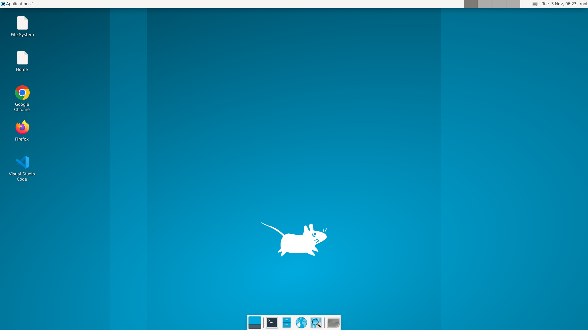

# xrdp-docker-lab

在 Docker 容器里跑一个开箱即用的远程桌面，通过 RDP 连接，预装中文输入法和中文字体，以及 Firefox / Chrome / VSCode 和常用开发工具链。

- `Dockerfile` — XFCE 桌面版（`xrdp-xfce:lab`）
- `Dockerfile.gpu` — GNOME 桌面（Ubuntu 24.04）+ NVIDIA GPU 版（`xrdp-gnome-gpu:lab`），额外预装 MuJoCo 仿真环境与 Ghostty 终端



## 特性

- 🖥️ **XFCE 桌面 + XRDP**：Windows 远程桌面（mstsc）或任何 RDP 客户端直连
- 🔌 **断线重连**：与宿主机相同的会话策略——断线即结束会话、重连续接原会话
- 🇨🇳 **中文开箱即用**：fcitx5 拼音输入法 + Noto CJK 字体，容器构建阶段即配置好
- 🌐 **浏览器双持**：Firefox（deb 版，经 Mozilla PPA）+ Chrome（官方 deb，已处理 root 沙箱问题）
- 📝 **VSCode**：官方 deb 安装，补齐图标并配置 gnome-keyring，不再弹 "OS keyring is not available"
- 🛠️ **开发工具链**：git、Node.js 22 LTS（npmmirror 镜像）、uv（清华 pypi 镜像）
- 💾 **数据持久化**：`/root` 挂载到宿主机目录，重建容器不丢数据；`/share` 用于宿主机↔容器交换文件

## 快速开始

### 1. 准备 VSCode 安装包

`code.deb`（约 250MB）不在仓库里，构建前需下载一次放入项目根目录。容器内访问微软官网可能超时，建议在宿主机经代理下载：

```bash
curl -x http://<你的代理地址>:7890 -sL -o code.deb \
  'https://code.visualstudio.com/sha/download?build=stable&os=linux-deb-x64'
```

### 2. 构建镜像

```bash
docker build -t xrdp-xfce:lab .
```

### 3. 运行容器

```bash
docker run -d --name xrdp-lab --init --shm-size=1g \
  -p 13389:3389 \
  -v /root/xrdp-docker-lab/home:/root \
  -v /root/xrdp-docker-lab/share:/share \
  xrdp-xfce:lab
```

### 4. 连接桌面

用 RDP 客户端连接 `localhost:13389`（局域网用宿主机 IP），账号 `root` / 密码 `root`。

> 首次登录后建议立即修改密码：`passwd`

### 5. 重建容器

数据都在 `home/` 目录里，重建不会丢：

```bash
docker rm -f xrdp-lab
docker run -d ...  # 同上
```

## GPU + GNOME 变体（Dockerfile.gpu）

在 XFCE 版相同的开发环境基础上：桌面换成 GNOME、基于 `nvidia/cuda`（Ubuntu 24.04）镜像、额外预装 MuJoCo 仿真环境（`/opt/mujoco` venv，`MUJOCO_GL=egl` 已配置好，登录后直接 `python -c "import mujoco"`）。

终端是 [Ghostty](https://ghostty.org)（GPU 加速，经社区 PPA 安装），已设为系统默认终端并固定在 dock 首位，桌面有快捷方式；系统等宽字体设为 JetBrains Mono（GNOME Terminal 跟随系统等宽字体）。Ghostty 是 GTK4 应用，中文输入依赖 `fcitx5-frontend-gtk4`，已预装。

### 1. 前置条件

- 宿主机安装 NVIDIA 驱动 + [NVIDIA Container Toolkit](https://docs.nvidia.com/datacenter/cloud-native/container-toolkit/install-guide.html)（`docker run --gpus all` 可用）
- 同样需要先把 `code.deb` 放入项目根目录

### 2. 构建镜像

```bash
docker build -f Dockerfile.gpu -t xrdp-gnome-gpu:lab .
```

### 3. 运行容器

```bash
docker run -d --name xrdp-gpu --gpus all --init --shm-size=1g \
  -p 23389:3389 \
  -v /root/xrdp-docker-lab/home-gpu:/root \
  -v /root/xrdp-docker-lab/share:/share \
  xrdp-gnome-gpu:lab
```

GPU 相关环境变量（`NVIDIA_VISIBLE_DEVICES=all`、`NVIDIA_DRIVER_CAPABILITIES=all`）已固化进镜像，无需额外 `-e`。

### 4. 连接桌面与验证

RDP 连接 `localhost:23389`，账号 `root` / 密码 `root`。验证 GPU 与 MuJoCo：

```bash
docker exec xrdp-gpu nvidia-smi
docker exec xrdp-gpu bash -lc 'python -c "import mujoco; print(mujoco.__version__)"'
```

## 目录结构

```
xrdp-docker-lab/
├── Dockerfile          # XFCE 版镜像定义（装什么、怎么配，全在这里）
├── Dockerfile.gpu      # GPU + GNOME 版镜像定义（额外含 MuJoCo）
├── start.sh            # XFCE 版容器启动脚本（启 dbus/xrdp + 幂等初始化 home）
├── start-gpu.sh        # GPU 版容器启动脚本（GNOME on Xorg 会话）
├── skel/               # 用户 home 模板（与 XFCE 版共用），启动时同步进容器
│   ├── Desktop/        # 桌面快捷方式（Firefox / Chrome / VSCode）
│   ├── fcitx5-profile  # 输入法配置（英文键盘 + 拼音）
│   └── helpers.rc      # XFCE 首选应用（通用浏览器 → Firefox）
├── skel-gpu/           # GPU 版专属 home 模板
│   └── Desktop/        # Ghostty 快捷方式
├── home/               # 数据卷：XFCE 版容器 /root 的持久化目录（git 已忽略）
├── home-gpu/           # 数据卷：GPU 版容器 /root 的持久化目录（git 已忽略）
└── share/              # 数据卷：宿主机↔容器文件交换（容器里挂 /share）
```

## 实现要点

- **Firefox 用 deb 而非 snap**：容器里没有 systemd，snap 不可用，改用 Mozilla PPA 并对该 PPA 设置 pin 优先级 1001 防止被 snap 过渡包顶掉。
- **Chrome 的 `--no-sandbox`**：root 运行必须加此参数，连系统 `.desktop` 文件一起改了，否则经 exo-open / 应用菜单启动会静默失败。
- **会话策略**：`sesman.ini` 设置 `KillDisconnected=true` + `Policy=UBD`，断线即结束会话、重连续接原会话。
- **home 幂等初始化**：`start.sh` / `start-gpu.sh` 每次启动检查并补齐 `.xinputrc`、fcitx5 配置、桌面快捷方式（含 `gio set metadata::trusted`），数据卷重建后无需手工配置。
- **GPU 版 GNOME on Xorg**：容器无 systemd/logind，`start-gpu.sh` 写入 `~/.xsessionrc` 显式声明 `XDG_SESSION_TYPE=x11` 等变量，GNOME 才能经 xrdp 正常拉起；GNOME Shell 的 LoginManager 强制依赖 `org.freedesktop.login1`（Ubuntu 源没有 elogind），`start-gpu.sh` 以独立模式后台拉起 `systemd-logind` 提供该 D-Bus 服务（注意容器里它不会自行 daemonize，前台运行会阻塞后续 xrdp 启动）；`NVIDIA_DRIVER_CAPABILITIES=all` 固化进镜像，保证 EGL/GL 库被挂载，MuJoCo 离屏渲染开箱可用。
- **Ghostty 与 24.04 基底**：Ghostty 要求 GTK ≥ 4.10（22.04 只有 4.6），故 GPU 版基底为 Ubuntu 24.04，经社区 PPA（`ppa:mkasberg/ghostty-ubuntu`）安装；系统等宽字体经 dconf 系统库设为 JetBrains Mono（键名是 `monospace-font-name`），默认终端与 dock 固定项同在此配置，用户可在桌面环境中自行覆盖。
- **UTF-8 locale 双保险**：xrdp 会话默认无 `LANG`（`nvidia/cuda` 基础镜像没有 `/etc/default/locale`），而 `gnome-terminal-server` 在非 UTF-8 locale 下直接拒绝启动（终端打不开）。镜像内生成 `zh_CN.UTF-8` 并写 `/etc/default/locale`，`start-gpu.sh` 每次启动重写 `~/.xsessionrc`（含 `export LANG=zh_CN.UTF-8`）做会话级保底；`.xsessionrc` 为镜像托管文件，重写而非条件创建，避免旧数据卷沿用缺失变量的历史版本。

## License

[MIT](LICENSE)
